# AWS Static Website: S3 + CloudFront CDN

A static website hosted on **Amazon S3** and delivered globally over **HTTPS** through the **Amazon CloudFront** content delivery network (CDN).

This project demonstrates a classic AWS DevOps workflow: storing website files in object storage, putting a CDN in front of them for speed and security, and verifying that caching behaves as expected.

---

## Overview

Instead of running a web server, this site is made of plain HTML files stored in an S3 bucket. S3 serves them as a website, and CloudFront sits in front to cache the content at edge locations around the world, encrypt traffic with HTTPS and compress responses.

The result is a fast, low-cost, serverless website with nothing to patch or maintain.

**Live URL:** `https://d1tgqz06l979ya.cloudfront.net` *(replace with your CloudFront domain; it stops working once the distribution is deleted)*

---

## Architecture

```
User (browser)
     |
     |  HTTPS
     v
Amazon CloudFront   -> caches content, serves HTTPS, compresses files
     |
     |  HTTP (only on a cache miss)
     v
Amazon S3 website endpoint   -> stores index.html and error.html
```

| Component | Role in this project |
|---|---|
| **Amazon S3** | Stores the website files and serves them through static website hosting |
| **Amazon CloudFront** | Caches the files at edge locations, adds HTTPS and compression |
| **Route 53** *(not used)* | Would map a custom domain to CloudFront; skipped because no domain was registered |

---

## How a request works

1. A visitor opens the CloudFront URL in their browser.
2. The request goes to the nearest CloudFront **edge location**.
3. **Cache hit:** if the edge already has the file, it is returned immediately.
4. **Cache miss:** if not, CloudFront fetches the file from the S3 website endpoint, stores a copy, and returns it.
5. Later visitors near that edge location get the cached copy without touching S3.

This is why the first request shows `x-cache: Miss from cloudfront` and later ones show `x-cache: Hit from cloudfront`.

---

## Project structure

```
.
├── index.html        # Home page, served at the root URL
├── error.html        # Custom error page shown for missing paths
├── README.md         # Project documentation
└── screenshots/      # Evidence of the working setup
```

---

## Configuration summary

### S3 bucket
| Setting | Value | Why |
|---|---|---|
| Static website hosting | Enabled | Lets S3 serve files like a web server |
| Index document | `index.html` | Page served at the root URL |
| Error document | `error.html` | Page served for missing paths |
| Block Public Access | Off | Visitors must be able to read the files |
| Bucket policy | Allow `s3:GetObject` for `*` | Read-only public access to all objects |

**Screenshots: S3 setup**

| What it shows | Screenshot |
|---|---|
| Bucket created, with Block Public Access turned off | 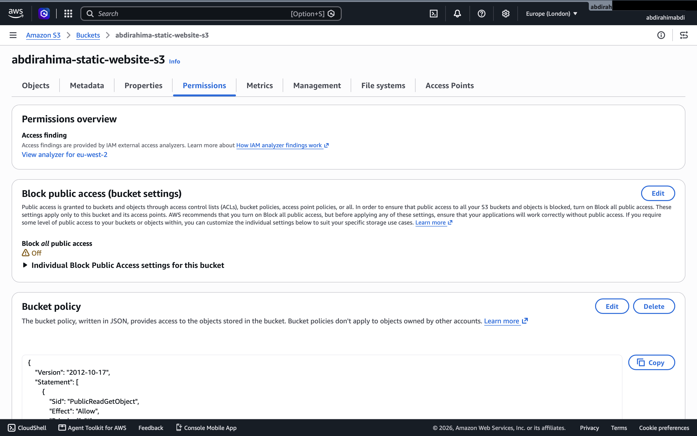 |
| Static website hosting enabled, with the website endpoint | 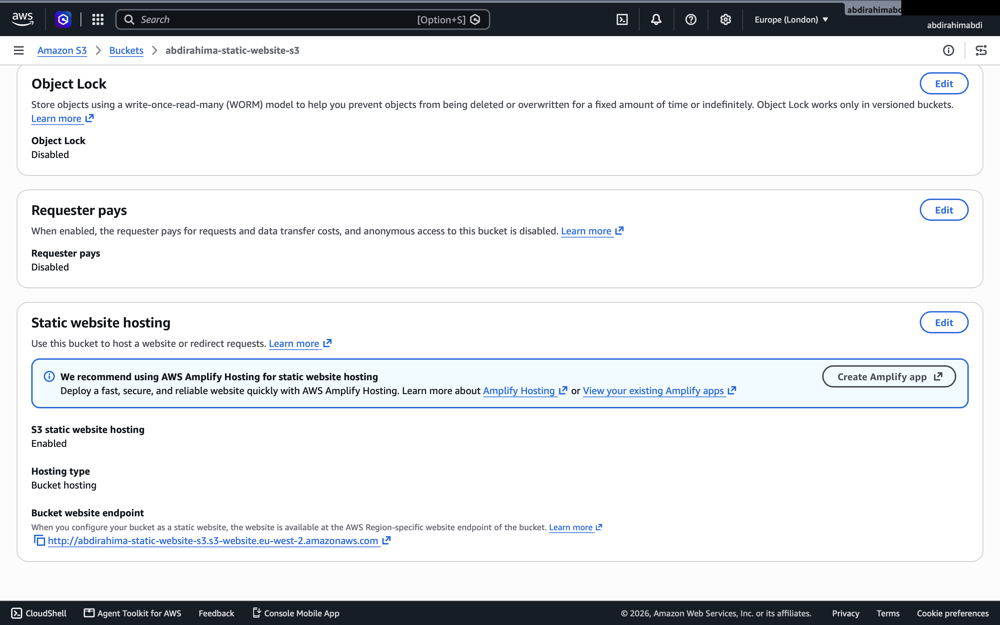 |
| Bucket policy allowing public read | 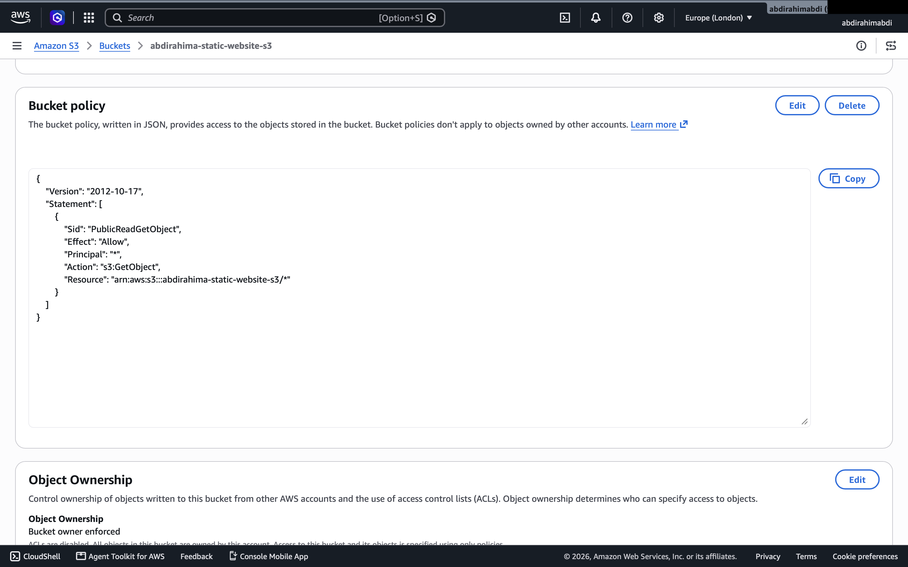 |
| Site working at the S3 website endpoint | 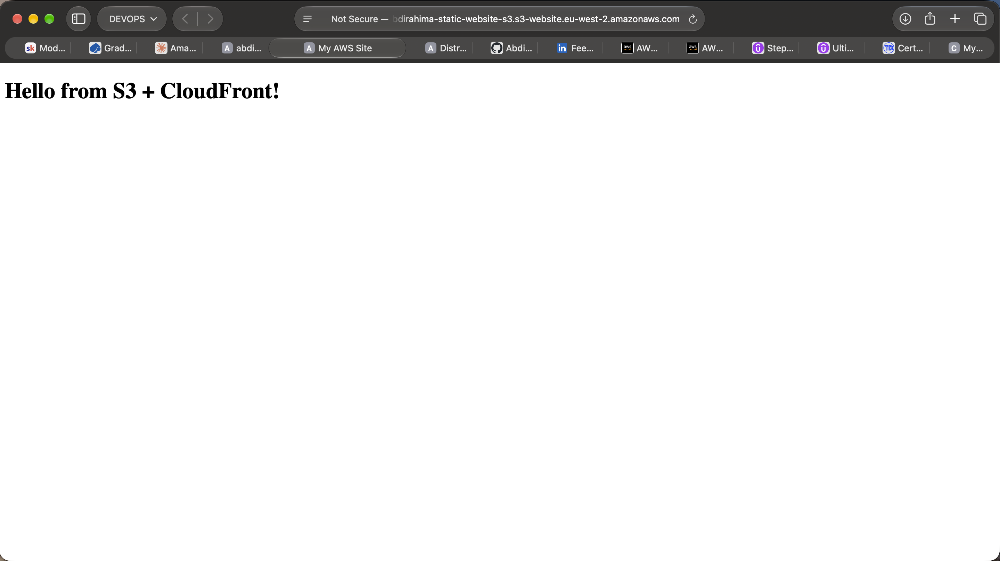 |

### CloudFront distribution
| Setting | Value | Why |
|---|---|---|
| Origin | S3 **website endpoint** | Supports index and error documents (the REST endpoint does not) |
| Origin protocol | HTTP only | S3 website endpoints do not support HTTPS |
| Viewer protocol policy | Redirect HTTP to HTTPS | Encrypts all visitor traffic |
| Allowed methods | GET, HEAD | A static site only needs read requests |
| Cache policy | CachingOptimized (managed) | AWS's recommended caching rules |
| Compression | Enabled | Smaller HTML/CSS/JS responses load faster |
| Default root object | `index.html` | Serves the home page at `/` |
| Certificate | Default `*.cloudfront.net` | No custom domain, so no ACM certificate needed |

**Screenshots: CloudFront setup**

| What it shows | Screenshot |
|---|---|
| Distribution settings (origin, protocol policy, cache policy, compression) | 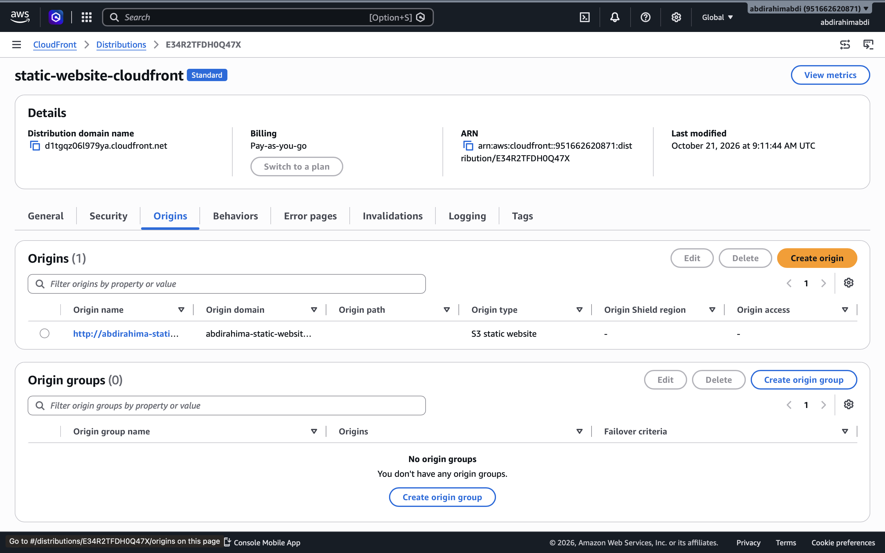 |
| Site served from the CloudFront domain | 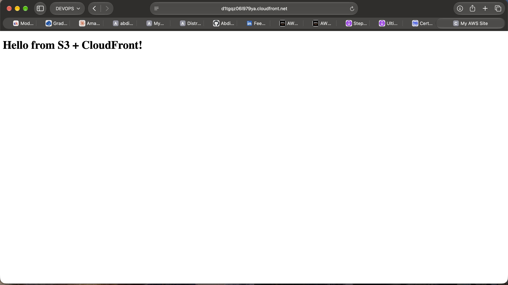 |
| Custom error page for a missing path (e.g. `/nothing`) | 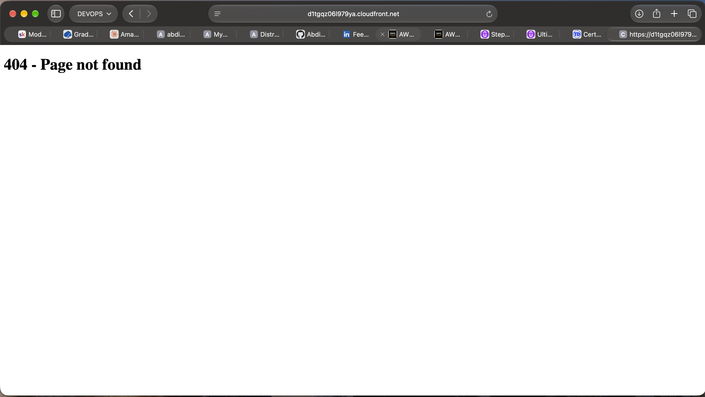 |

---

## Key concepts demonstrated

**Static website hosting.** S3 can serve HTML files directly, with index and error pages, and no server to manage.

**Bucket policies.** Access to S3 is controlled by JSON policies. This project allows anyone to read objects but not write or delete them.

**CDN and edge caching.** CloudFront copies content to servers close to users, which lowers latency and reduces load on the origin.

**HTTPS everywhere.** CloudFront terminates TLS using its default certificate and redirects any HTTP request to HTTPS.

**Compression.** CloudFront compresses text files with gzip or brotli before sending them.

**Cache invalidation.** Cached copies stay at the edge until they expire. After updating a file in S3, an invalidation (`/*`) forces edge locations to fetch the new version.

---

## Verification and results

The setup was tested in three ways:

1. **The site loads over HTTPS** from the CloudFront domain, and `http://` redirects to `https://`.
2. **Caching works.** Running `curl -I` twice shows `Miss from cloudfront` first, then `Hit from cloudfront`, plus a rising `age` value.
3. **Invalidation works.** After changing the page to *Version 2* and re-uploading it, the site still showed *Version 1* (cached) until a CloudFront invalidation completed, after which *Version 2* appeared.

```bash
curl -I https://dxxxxxxxx.cloudfront.net
```

Headers to look for:
- `HTTP/2 200`
- `via: ... (CloudFront)`
- `x-cache: Miss from cloudfront` / `Hit from cloudfront`

### Screenshots: testing

**1. Caching: first request (cache miss)**
The first `curl -I` shows `x-cache: Miss from cloudfront`, meaning CloudFront had to fetch the file from S3.

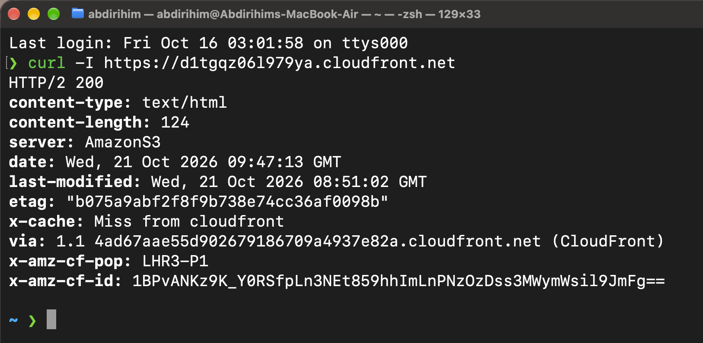

**2. Caching: second request (cache hit)**
The same command run again shows `x-cache: Hit from cloudfront` and an `age` value, meaning the file came from the edge cache.

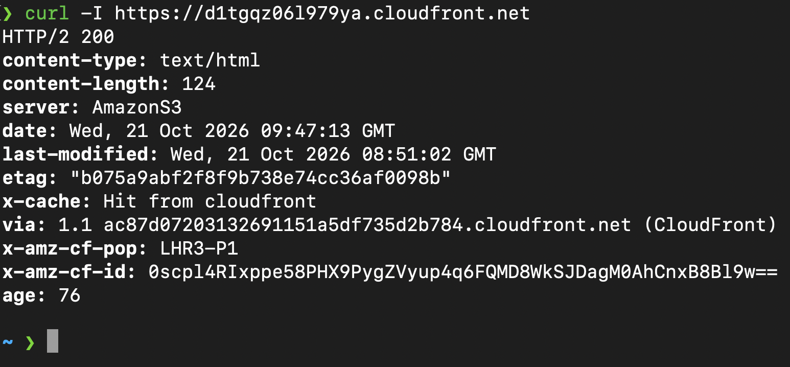

**3. Before invalidation: still showing Version 1**
After editing and re-uploading `index.html`, the site still shows the old version because the cached copy is still being served.

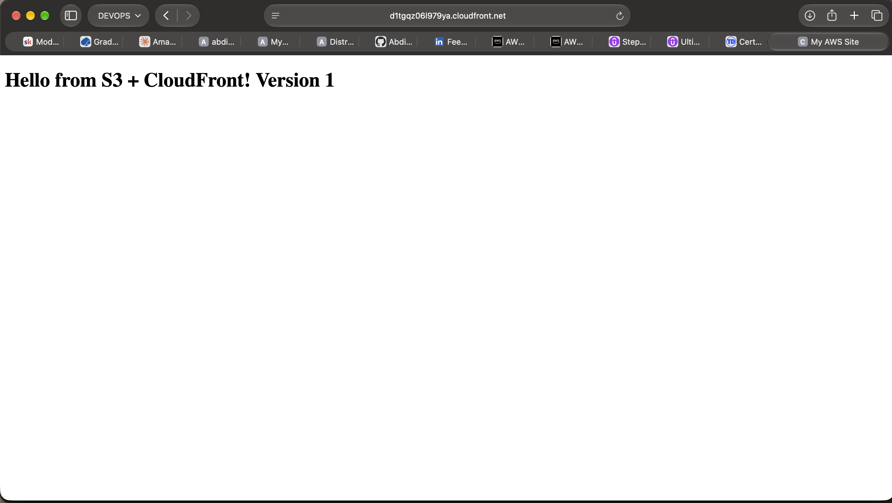

**4. Invalidation completed**
A CloudFront invalidation for `/*` with status **Completed**.

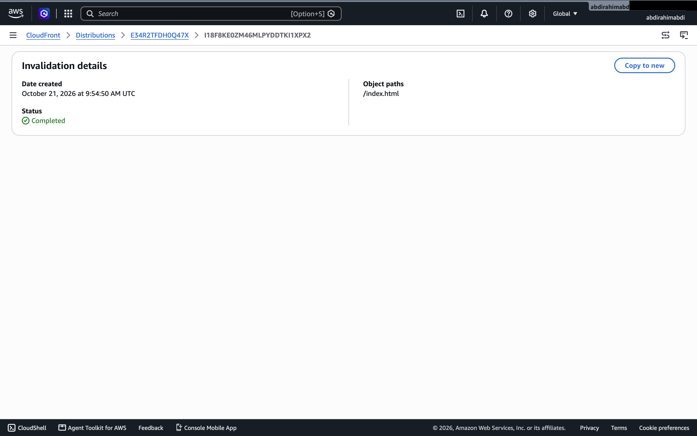

**5. After invalidation: Version 2**
After the invalidation, the site shows the updated page.

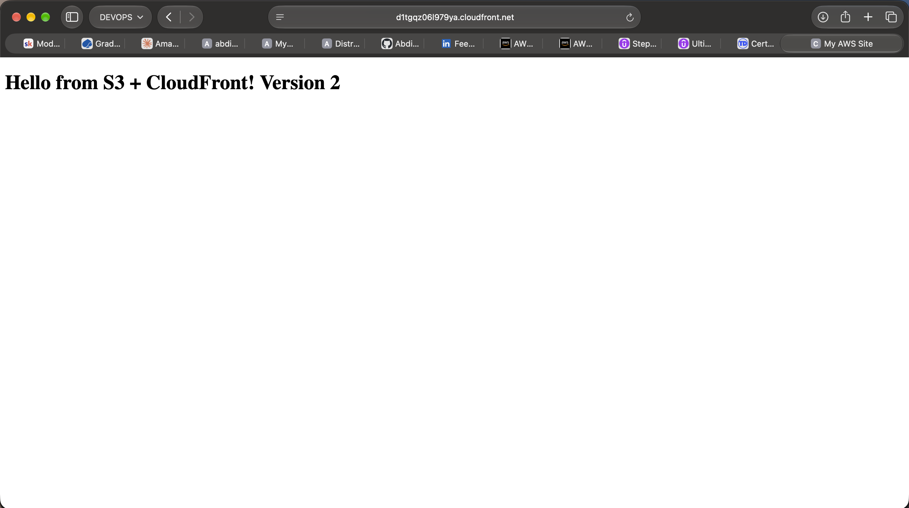

### Screenshot checklist

Save each image in the `screenshots/` folder using exactly these names (or edit the links above to match yours):

| File name | What to capture |
|---|---|
| `01-s3-bucket-created.png` | S3 bucket page showing the bucket and public access settings |
| `02-s3-website-hosting-enabled.png` | Properties tab, Static website hosting section with the endpoint |
| `03-s3-bucket-policy.png` | Permissions tab, bucket policy |
| `04-s3-website-endpoint.png` | Browser showing the S3 website endpoint |
| `05-cloudfront-settings.png` | CloudFront distribution details and origin settings |
| `06-cloudfront-site.png` | Browser showing the site on the `cloudfront.net` URL |
| `07-cloudfront-error-page.png` | Browser showing the 404 page at `/nothing` |
| `08-curl-cache-miss.png` | Terminal, first `curl -I` run |
| `09-curl-cache-hit.png` | Terminal, second `curl -I` run |
| `10-version1-cached.png` | Browser still showing Version 1 after the S3 edit |
| `11-invalidation-completed.png` | CloudFront Invalidations tab showing **Completed** |
| `12-version2-after-invalidation.png` | Browser showing Version 2 |

**Tip (macOS):** press **Cmd + Shift + 4** and drag to capture an area, or **Cmd + Shift + 5** for more options. Screenshots save to your Desktop by default; rename and move them into the `screenshots/` folder.

---

## Challenges and lessons learned

- **Two S3 endpoints exist.** The REST endpoint (`bucket.s3.region.amazonaws.com`) and the website endpoint (`bucket.s3-website.region.amazonaws.com`) behave differently. Only the website endpoint supports index and error documents.
- **Origin protocol matters.** S3 website endpoints only speak HTTP, so CloudFront must use HTTP only to the origin; visitors still get HTTPS.
- **Caching can hide updates.** Changes to S3 do not appear until the cache expires or is invalidated, which is the main operational cost of using a CDN.
- **Safari hides the padlock.** HTTPS was confirmed from the full URL and `curl -I` rather than the address bar icon.

---

## Security considerations

This project uses a **public bucket** because it is the simplest setup for a static website. It works, but it has trade-offs: the bucket can be reached directly, bypassing CloudFront, and the S3 origin connection uses plain HTTP.

For production, the recommended design is a **private bucket with Origin Access Control (OAC)**, so only CloudFront can read the files and all access goes through the CDN. Adding **AWS WAF** and response security headers would harden it further.

---

## Possible improvements

- Register a domain in **Route 53** and add an **Alias A record** pointing to the distribution
- Attach an **ACM certificate** (requested in `us-east-1`) for HTTPS on the custom domain
- Switch to a **private bucket with OAC**
- Automate deployment with **GitHub Actions** (upload to S3, then invalidate CloudFront)
- Define the infrastructure as code with **Terraform** or **CloudFormation**
- Enable CloudFront **access logs** for monitoring

---

## Cost and cleanup

At this scale the project is effectively free under the AWS free tier. To avoid ongoing charges after the assignment:

1. Disable, then delete, the CloudFront distribution
2. Empty, then delete, the S3 bucket

---

## Technologies

`Amazon S3` · `Amazon CloudFront` · `HTML` · `AWS Console` · `curl`